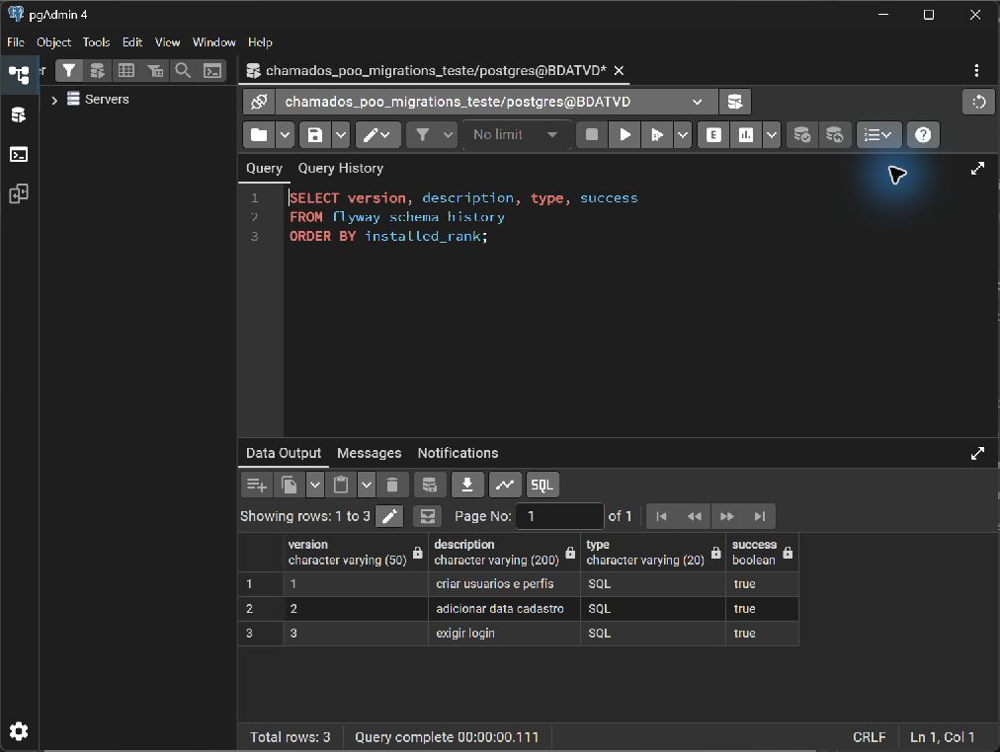

# Atividade 18 - Migrations

## Inicialização

Flyway Core e o módulo PostgreSQL estão no pom.xml. JPAUtil carrega a conexão local, executa MigracaoBanco.migrar() e só então abre a fábrica JPA; o Hibernate usa validate e não cria nem altera tabelas.
As migrations SQL ficam em `prg03fabriciocardoso/src/main/resources/db/migration` e são executadas pelo código.

## Versões

- V1 cria usuarios, perfis e usuario_perfis com tipos, identidades, chaves primárias, referências, status válido e login único.
- V2 adiciona data_cadastro, preenchendo os registros existentes com CURRENT_TIMESTAMP; Usuario mapeia o campo como LocalDateTime.
- V3 torna login obrigatório, em acordo com @Column(nullable = false).

O SQL foi escrito para o domínio; não depende da geração de DDL do Hibernate. dataNascimento usa o identificador não delimitado do PostgreSQL, compatível com o mapeamento anterior.
A validação confirmou a correspondência entre SQL e entidades, sem divergências pendentes.

## Banco existente

O banco chamados_poo da atividade anterior foi preservado: seu esquema inicial foi adotado explicitamente como baseline 1, e V2/V3 foram aplicadas pelo Flyway. Não há baseline automático na aplicação.
Em outro banco com tabelas anteriores, faça backup, confirme a compatibilidade com V1 e execute baseline 1 explicitamente antes da primeira inicialização; em banco vazio, V1/V2/V3 são aplicadas normalmente.
As credenciais e o persistence.xml real continuam ignorados; somente persistence.xml.exemplo é versionado.

## Prova do zero

O banco separado chamados_poo_migrations_teste foi criado, confirmado vazio, excluído com DROP DATABASE e recriado com o mesmo proprietário. O arquivo recriar_banco_teste.sql repete essa etapa e deve ser executado como administrador, conectado a outro banco e sem sessões abertas no banco de teste. Nenhum banco de outra atividade foi excluído.
A inicialização pelo JPAUtil aplicou V1, V2 e V3 em sequência; a fábrica JPA abriu com validate. O print flyway_schema_history.jpg mostra as três versões SQL concluídas com sucesso.
A aplicação foi inicializada novamente e nenhuma migration foi reaplicada.

## Testes

A bateria completa passou com 22 testes, incluindo CRUD, rollback e histórico das migrations no banco recriado.
Para repetir o teste completo em um banco exclusivo vazio, configure o persistence.xml local e execute no módulo Maven: POO_TEST_POSTGRES=true e POO_TEST_MIGRATIONS=true, com `mvn -Dpoo.jdbc.url=jdbc:postgresql://localhost:5432/NOME_DO_BANCO test`.
Sem essas variáveis, os testes que exigem PostgreSQL são ignorados; os testes de domínio continuam disponíveis com `mvn clean test`.

## Referências

[Flyway PostgreSQL](https://documentation.red-gate.com/flyway/reference/database-driver-reference/postgresql-database) e [baseline de banco existente](https://documentation.red-gate.com/flyway/reference/commands/baseline).
